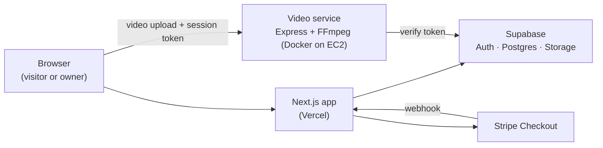

# Slate CMS

A website with a built-in, owner-only content editor. To visitors it is an ordinary marketing site. The owner logs in through a hidden button and can change the site's text, images and videos in place, without a developer.

I first built this for a client's website at no extra charge, so they could update their own content. This repository is a separate demo copy: it has its own Supabase project, Stripe test account and video service, and shares no data with the client's site.

**Live demo:** [slate-sage.vercel.app](https://slate-sage.vercel.app/). Scroll to the bottom of the home page and click the small **FJ** box to open the login page. Demo credentials are shown there. Please be kind to the demo content.

## Features

- **In-place editing:** text, images and videos are edited directly on the page by a logged-in owner and stored in Supabase.
- **Owner-only access:** Supabase Auth sessions, with row-level security policies on the content tables and storage buckets.
- **Video compression service:** uploaded videos are re-encoded with FFmpeg (H.264, max 1080px wide, web-optimised) by a separate Node.js service before they are stored.
- **Stripe checkout:** monthly subscription plans in Stripe test mode, with prices set on the server and signature-checked webhooks.
- **CI/CD:** every pull request runs the backend tests. Pushes to `staging` and published releases build a Docker image and deploy it to AWS EC2.

## Architecture



The video service only accepts uploads with a valid Supabase session token, so it can't be used by anyone who isn't logged in.

## Tech stack

| Area | Tools |
|---|---|
| Frontend | Next.js 15, React 19, Tailwind CSS |
| Auth, database, storage | Supabase (Auth, Postgres with RLS, Storage buckets) |
| Video service | Node.js, Express 5, Multer, FFmpeg |
| Payments | Stripe Checkout and webhooks |
| DevOps | Docker, Docker Hub, GitHub Actions, AWS EC2, AWS SSM, OIDC |
| Testing | Jest, Supertest |

## The video service (`backend/`)

`POST /resize` takes a multipart upload in a `video` field and returns the compressed MP4.

| Check | Response |
|---|---|
| Missing or invalid Supabase token | 401 |
| No file | 400 |
| File isn't a video type | 415 |
| File over the size limit (200 MB by default) | 413 |
| File can't be read as a video | 422 |
| Server already running its maximum number of jobs | 503 |

Each upload gets its own temporary files, which are deleted whether the job succeeds or fails. `GET /health` returns `{"status":"ok"}`.

## Deployment pipeline

- **CI** (`.github/workflows/ci-pipeline.yaml`): runs the backend test suite on every pull request to `main` or `staging`.
- **CD** (`.github/workflows/cd-pipeline.yaml`):
  - Tests, then builds the Docker image and pushes it to Docker Hub with an immutable commit-SHA tag.
  - Authenticates to AWS with GitHub's OIDC provider, so no long-lived AWS keys are stored in GitHub.
  - Deploys to EC2 through AWS SSM, with no SSH. Containers listen only on localhost: production on port 5001, staging on 5002. Nginx terminates HTTPS and forwards to production.
  - The container reads its settings from `/etc/slate/backend.env` on the instance.
  - The Nginx site config is in `deploy/nginx-slate.conf`.

## Running locally

Requirements: Node.js 20+, a Supabase project and a Stripe test account.

```bash
# Video service
cd backend
cp .env.example .env      # fill in your Supabase URL and anon key
npm ci
npm test
npm run dev               # http://localhost:5000

# Next.js app (in a second terminal)
cd my-app
cp .env.example .env.local
npm ci
npm run dev               # http://localhost:3000
```

## Known limitations

This is a demo, and these are deliberate trade-offs or next steps:

- There is a single owner account and no sign-up. That is by design for a personal site.
- Stripe payments are logged but don't unlock anything, since the demo has no paid features.
- The Supabase table and storage policies are managed in the Supabase dashboard and aren't yet version-controlled as migrations.
